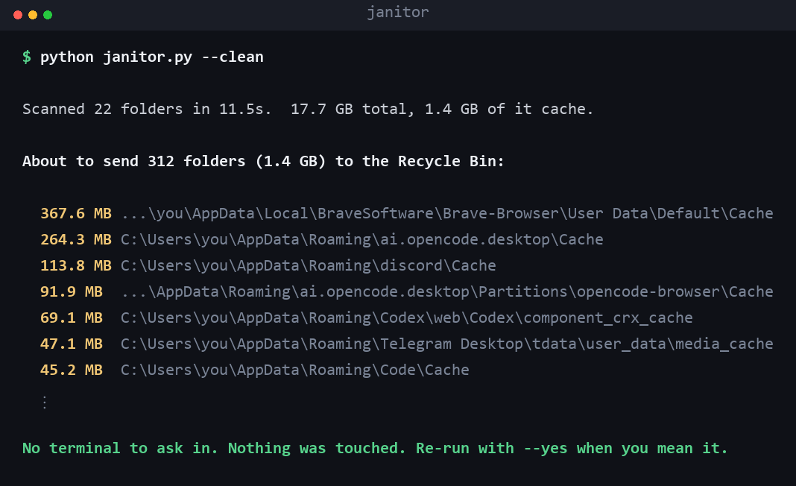

# janitor


Tells you what is eating your disk, in plain words, and only then offers to move the safe parts to the Recycle Bin.



<sub>Folder names are shown as `C:\Users\you`. The sizes are real.</sub>

Three verdicts, and nothing else:

| Mark | Means | Why |
| :--- | :--- | :--- |
| `-` | **safe** | cache, temp, logs, crash dumps. The app rebuilds it on its own. |
| `?` | **ask** | might be disposable, might be yours. It says why, you decide. |
| `!` | **leave alone** | Windows, installed software, `.git`, your documents. |

## The rules are the product

Anyone can sum folder sizes. The useful part is knowing that `Code Cache` is disposable and `@opencodedesktop-updater` is not, because an update is sitting in it waiting to install. `RULES` in `janitor.py` is an ordered list of those decisions, each with the reason printed next to it:

```python
# (kind, value, verdict, why)
#   seg  - one folder name is exactly this
#   end  - one folder name ends with this
#   path - the path contains this
("seg", "myapp-temp", SAFE, "my app rebuilds this on startup"),
```

Matching is by whole folder name, not substring. `Template` is not temp, `Tempest` is not temp, `cache2` is not a cache. Add your own rule in one line.

## Nothing gets deleted

`--clean` sends folders to the **Recycle Bin**, not the void. If you got it wrong, restore it. It also refuses outright, no matter what a rule says:

- `Desktop`, `Documents`, `Pictures`, `Videos`, `Music`, `OneDrive`, `Dropbox`
- `C:\Windows`, `C:\Program Files`, `C:\Program Files (x86)`
- anything in a `.git` folder
- `%TEMP%\opencode`, because coding agents keep working files there while they run

Locked files are skipped and reported, so a running browser does not stop the rest.

## Usage

```bash
python janitor.py                  # report only, touches nothing
python janitor.py --clean          # show the plan, ask, then recycle
python janitor.py --clean --yes    # no question
python janitor.py --top 40         # longer list
python janitor.py --min 500MB      # ignore small stuff
python janitor.py --roots "D:\\"   # look somewhere else
python janitor.py --json           # for scripting
```

Python 3.9 or newer. No dependencies, no install.

## Tests

```bash
python test_janitor.py
```

They build a fake disk in a temp folder and check that real data and protected folders survive a clean, and that the updater folders are never classified as safe. Nothing real is touched.

## Known limits

- Windows only. The Recycle Bin call is `SHFileOperationW`.
- It sizes folders, it does not find single huge files. Use a tree viewer for that.
- Rules are name based, so a folder you named `cache` on purpose will be treated as a cache. The protected list covers the usual accidents, not all of them.
- A locked folder is skipped, not forced. Close the app and run it again.
